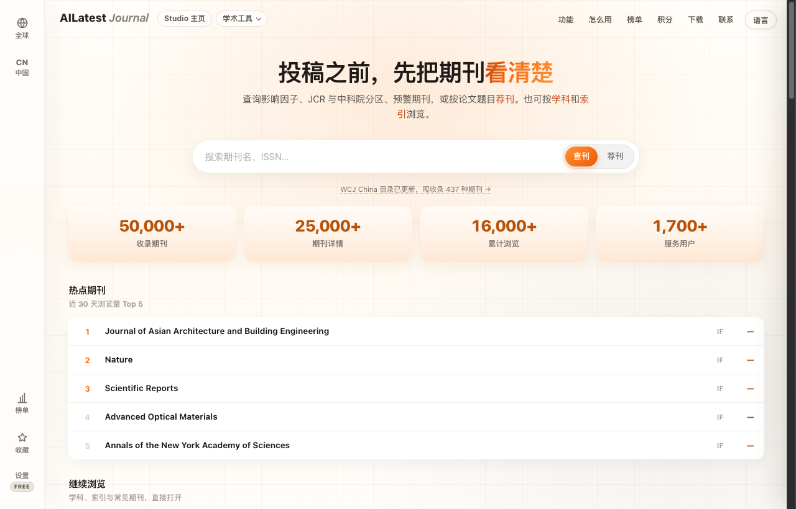

  <b>English</b> | <a href="#chinese"><b>中文说明</b></a>

# AILatest Journal (知刊) · Global Academic Journal Finder & Risk Monitor 📚

  <b>Comprehensive academic journal finder, JCR/CAS quartile comparator, and early warning risk monitor.</b> 
  投稿之前，先把期刊看清楚。覆盖 50,000+ 本全球学术期刊，汇聚最新 JCR 影响因子、中科院升级版分区、官方预警与智能推荐。

  
  
  
  
  

---

## 🖼 Visual Showcase

### 1. Official Cover Art

  

### 2. Live Application Interface

  

<em>Live screenshot captured from production: <a href="https://journal.ailatest.org/">journal.ailatest.org</a>.</em>

---

## 📊 Database Scale & Indexing Coverage

| Metric | Category | Count | Description |
| :--- | :--- | :---: | :--- |
| **Total Journals** | **All Indexed Venues** | **50,548+** | Complete global & regional academic periodicals |
| **SCIE** | Science Citation Index Expanded | **9,433** | Clarivate core scientific catalog |
| **SSCI** | Social Sciences Citation Index | **3,538** | Clarivate social science core catalog |
| **AHCI** | Arts & Humanities Citation Index | **1,799** | Clarivate humanities core catalog |
| **ESCI** | Emerging Sources Citation Index | **9,355** | Emerging high-growth journal index |
| **EI** | Engineering Index (Compendex) | **4,887** | Engineering and applied science index |
| **Scopus** | Elsevier Scopus | **29,887** | Broad peer-reviewed literature database |
| **DOAJ** | Directory of Open Access Journals | **23,208** | Certified open-access periodicals |
| **MEDLINE** | NLM Current Journals | **5,368** | Biomedical and clinical literature |
| **JCR IF 2025** | Impact Factor Metrics | **21,975** | Latest JCR release impact factors & quartiles |
| **CAS Zones** | 中科院升级版分区 | **21,695** | Includes 1-4 tiers and TOP journal tags |
| **Review Cycles** | Turnaround Statistics | **26,070** | Real-world submission-to-acceptance duration |
| **Discipline Lists** | Professional Society Ranks | **Multi** | CCF (279), ABDC (2,651), ABS (1,822), CNKI (6,038) |

---

## 🌟 Key Features

1. **Multi-Dimensional Journal Discovery**: Instant real-time search by full journal title, ISO abbreviation, or ISSN/eISSN with filters for indexing database, subject discipline, OA model, and APC fees.
2. **Side-by-Side Candidate Comparison**: Add up to 5 candidate journals to a comparison drawer to evaluate Impact Factors, CAS quartiles, acceptance rates, turnaround cycles, and review rigor on a single screen.
3. **Early Warning Risk Monitor**:
   - **CAS Warning List (中科院预警名单)**: Dynamic tracking of all high/medium/low-risk flagged journals.
   - **CITIC Warning List (中信所预警)**: Timely coverage of domestic research alerts.
   - **Clarivate WoS On-Hold**: Immediate notification of journals paused for editorial re-evaluation.
4. **"Pick for Me" (智能荐刊)**: Input your paper's title and abstract to receive algorithmic journal recommendations based on semantic match, target IF range, and acceptance speed.
5. **PWA Offline Support**: Installable as a Progressive Web App on macOS, Windows, iOS, and Android for instant offline access.

---

### 🏷 Related Topics & Search Keywords
`journal-finder` · `impact-factor-2025` · `jcr-quartiles` · `cas-zones` · `scie-journals` · `ssci-journals` · `wos-on-hold` · `journal-warning-list` · `ai-journal-recommender` · `open-access-apc` · `review-cycles`

---

  <a href="#top"><b>Back to Top (English)</b></a> | <b>中文说明</b>

## 🇨🇳 中文介绍 · AILatest Journal (知刊)

### 为什么需要知刊？
学术期刊投稿周期长、试错成本极高。投稿前如果未能摸清期刊的真实分区或遭遇官方预警，可能导致研究成果无法通过评审或延期毕业。

**知刊（Journal）** 汇聚全网最全面的学术期刊评价指标与风险预警：
1. **全球 50,000+ 本期刊一站式对比**：不再需要辗转于各大学会与商业数据库，同屏呈现 JCR 影响因子、JCR Quartile 分区、中科院文献情报中心升级版大类/小类分区及 TOP 标记。
2. **多源预警与异常状态实时监控**：
   - 官方中科院预警名单（含高、中、低风险分级）；
   - 中信所预警名单；
   - WoS 官方 On Hold / Under Review 剔除风险期刊实时预警。
3. **真实审稿周期与版面费（APC）**：收录 26,000+ 本期刊的初审周期、录用难度与出版费用，辅助精准规划投稿节奏。
4. **智能荐刊 (Pick for Me)**：输入拟投稿论文标题与摘要，系统基于语义向量与历史刊载风格推荐适配期刊清单。
5. **双语界面与 PWA 支持**：支持中英文无缝切换，支持直接安装至桌面或移动端离线检索。

🌐 **立即在线体验**：[**https://journal.ailatest.org/**](https://journal.ailatest.org/)

### 🏷 热门搜索关键词与相关主题
`知刊` · `期刊查询` · `SCI期刊查询` · `影响因子查询` · `中科院分区` · `中科院预警期刊名单` · `WoS剔除预警` · `论文投稿选刊` · `智能荐刊` · `SSCI目录` · `EI期刊` · `审稿周期查询` · `版面费APC`
