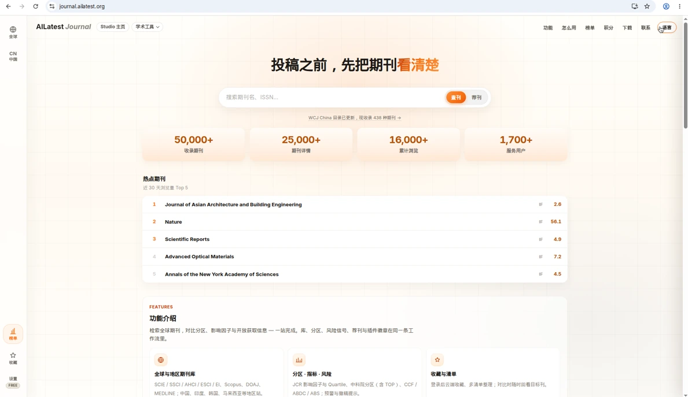
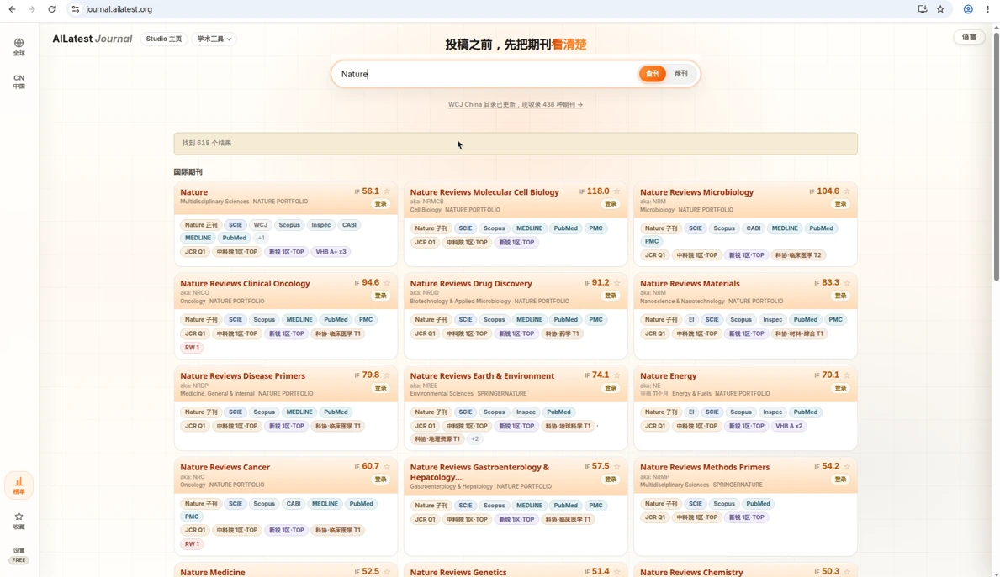
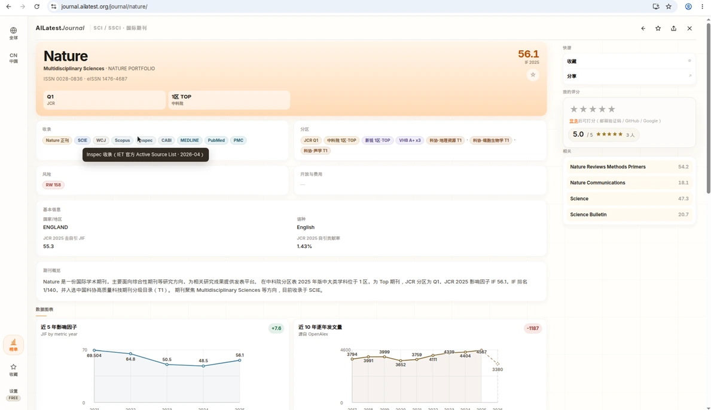
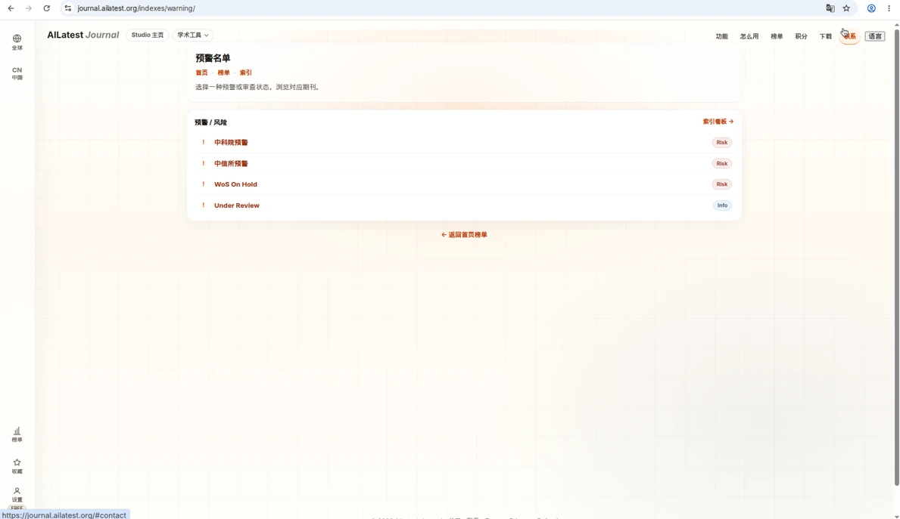
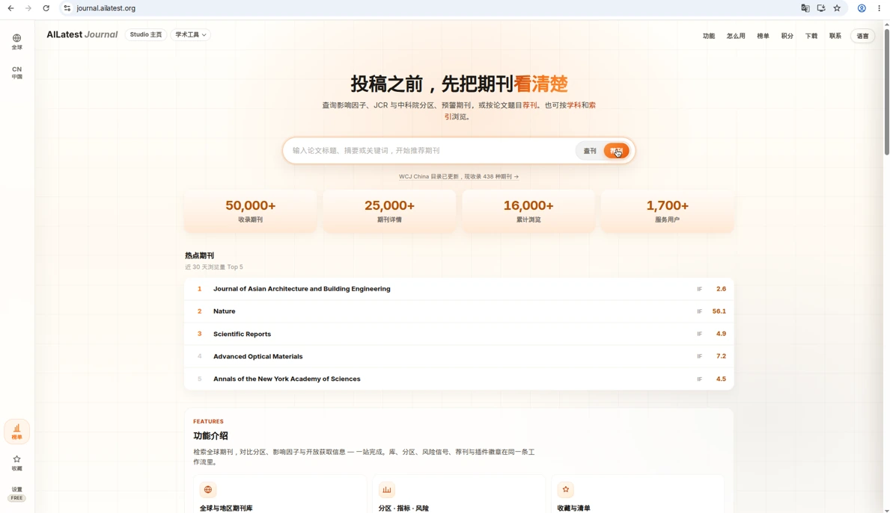
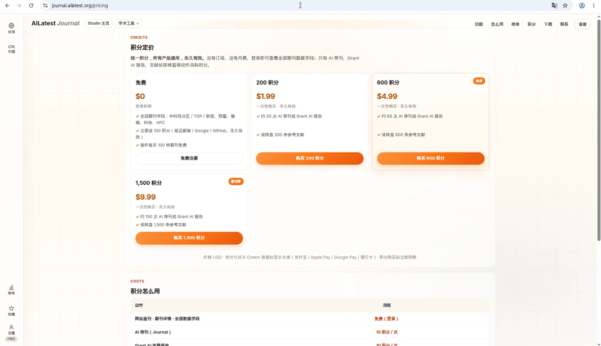

# 知刊 · AILatest Journal

**投稿前，把分区、收录、预警和候选刊放在同一页。**

Compare rankings, indexing, warning signals, and candidate venues before you submit.

[打开知刊](https://journal.ailatest.org) · [积分定价](https://journal.ailatest.org/pricing) · [关于与数据](https://journal.ailatest.org/about) · [AILatest 产品页](https://ailatest.org/projects/journal/)

  

<em>首页检索。截图来自 <a href="https://journal.ailatest.org">journal.ailatest.org</a>。 Home search, captured from the live site.</em>

本仓库是知刊的**公开项目页**：产品说明、界面截图和社区入口。生产代码由私有仓库维护，Cloudflare 从该私有源部署线上站点。这里不存放账号、支付记录、密钥，也不再分发受许可的期刊数据集。

This repository is the public project page for AILatest Journal: the product story, interface screenshots, and the community entry point. Production code stays in a private repository, and Cloudflare deploys the live site from that source. Accounts, payment records, secrets, and licensed journal datasets are not stored here.

## 能做什么

*What you can do*

- **检索全球与地区期刊。** 按刊名、缩写、ISSN、学科、索引和开放获取筛选。覆盖 SCIE / SSCI / AHCI / ESCI、EI、Scopus、DOAJ、MEDLINE，以及中国、印度、韩国、马来西亚等地区目录。 Search by title, abbreviation, ISSN, subject, index, and open access, including major international indexes and regional directories.
- **对照分区、指标与风险。** 查看 JCR 影响因子与 Quartile、中科院分区（含 TOP）、CCF / ABDC / ABS，以及预警与撤稿提示。 Compare JCR impact factor and quartile, CAS zones (including TOP), CCF / ABDC / ABS, plus warning and retraction cues.
- **打开期刊详情。** 收录徽章、OA / APC、审稿周期（有公开数据时才展示）、出版商和外部链接集中在一页。 Open a journal page for indexing badges, OA / APC, review-cycle notes when a public figure exists, publisher, and outbound links.
- **智能荐刊。** 输入论文标题、摘要或关键词，按研究主题和收录范围生成候选清单，并区分优先推荐与备选。荐刊用来缩小范围，不构成录用或评价承诺。 Paste a title, abstract, or keywords to build a shortlist. Matching supports comparison; it is not a promise of acceptance.
- **登录后收藏与清单。** 云端收藏，把目标刊整理成多份清单，比较时可以回看。 Sign in to save cloud favorites and keep more than one submission list.
- **插件与移动入口。** 浏览器插件在 Scholar、PubMed、知网等阅读页展示分区与收录徽章。关于页同时说明微信小程序提供移动端查询与收藏。 A browser extension shows ranking and indexing badges on Scholar, PubMed, and CNKI. The about page also describes a WeChat mini program for mobile lookup and saves.
- **中英界面。** 站点提供中文 / English，可在页头切换。 The interface is Chinese and English, with a language switch in the header.

## 界面

*The interface*

### 检索结果

*Search results*

  

刊名或 ISSN 直接查。列表上可以按索引、JCR、中科院分区和学科继续收窄。

Search by title or ISSN, then narrow the list by index, JCR, CAS zone, and subject.

### 期刊详情

*Journal detail*

  

详情页把投稿前最常核对的字段放在一起：影响因子、分区、收录、开放获取和出版商。页面上的指标以各来源的公开版本为准，具体年份和截止日期见[关于与数据说明](https://journal.ailatest.org/about)。

The detail page gathers the fields most useful before submission. Metrics follow the public edition of each source; years and cutoffs are listed on the about page.

### 预警与风险

*Warnings and risk signals*

  

预警名单把中科院预警、中信所预警、WoS On Hold 和 Under Review 分列出来。这些标记是风险提示，正式投稿前仍需核对期刊官网和评价机构的原文。

The warning index separates CAS warnings, CITIC warnings, WoS On Hold, and Under Review. Treat the badges as risk cues and confirm them with the journal and the issuing organization.

### 荐刊

*Recommend*

  

在首页把搜索切到「荐刊」，或打开荐刊页，贴上标题、摘要和关键词。需要服务端额度时会要求登录；访客可以先使用页面上的本地匹配。

Switch the home search to Recommend, or open the recommend page, and paste a title, abstract, and keywords. Server-side quota requires sign-in; guests can start with the on-page local matcher.

## 怎么用

*How it works*

1. **搜索或荐刊。** 用刊名 / ISSN 直接查，或切换到荐刊，贴上论文标题和摘要。 Search by title or ISSN, or switch to Recommend and paste the manuscript.
2. **按分区与库筛选。** 用 JCR、中科院、索引和学科收窄候选列表。 Filter by JCR, CAS zone, index, and subject.
3. **看详情与风险。** 在同一页核对影响因子、审稿周期、OA / APC、预警和撤稿提示。 Read impact, review cycle, OA / APC, warnings, and retraction cues on one page.
4. **收藏或带去阅读页。** 加入清单；浏览器插件在 Scholar、PubMed、知网页面继续对照徽章。 Save a list, or keep comparing badges in the browser extension.

## 积分

*Credits*

  

知刊使用 AILatest 统一积分：全产品通用，永久有效。没有订阅，没有月费。登录后可以查看全部期刊数据字段；AI 荐刊等动作才消耗积分。注册（验证邮箱，或使用 Google / GitHub）会获赠积分。价格、额度和支付方式以[定价页](https://journal.ailatest.org/pricing)当时显示为准。

AILatest uses one credit balance across products. Credits do not expire. There is no subscription and no monthly fee. Signed-in search shows every journal data field; actions such as AI journal matching spend credits. Signup with a verified email, Google, or GitHub includes a starter grant. Prices, quotas, and payment methods follow the [pricing page](https://journal.ailatest.org/pricing).

## 关于本仓库

*About this repository*

| | |
| --- | --- |
| 线上产品 Live product | [journal.ailatest.org](https://journal.ailatest.org) |
| 工作室 Studio | [ailatest.org](https://ailatest.org) · [知刊产品页](https://ailatest.org/projects/journal/) |
| 这个仓库 This repo | 公开说明、截图、Issue。 Public docs, screenshots, and issues. |
| 生产代码 Production code | 私有仓库，不在这里。 Private repository, not in this tree. |
| 数据 Data | 聚合公开评级与元数据，供检索和投稿参考。著作权归原发布机构。 Public ratings and metadata for search and submission planning. Copyright stays with the original publishers. |

知刊与 Clarivate、Elsevier、中科院文献情报中心等评价机构没有隶属或背书关系。Web of Science、JCR、Scopus、中科院分区等名称属于各自权利人。

AILatest Journal is not affiliated with or endorsed by Clarivate, Elsevier, the CAS documentation center, or other rating bodies. Names such as Web of Science, JCR, Scopus, and CAS zones belong to their owners.

发现元数据、收录状态或分区错误时，请通过[关于页](https://journal.ailatest.org/about)的联系方式提交公开来源和更正依据。也可以在本仓库开 Issue。

Editors, publishers, and researchers can report a metadata, indexing, or ranking error through the contact path on the [about page](https://journal.ailatest.org/about), with a public source. GitHub Issues on this repo are also open.

## 参与

*Contributing*

公开问题、可复现的问题和功能建议请使用 [GitHub Issues](https://github.com/stonecanon/ailatest-journal/issues)。中文或 English 都可以。请不要在 Issue 或 Pull Request 里粘贴密钥、支付信息或期刊数据文件。说明见 [CONTRIBUTING.md](CONTRIBUTING.md)。

Use [GitHub Issues](https://github.com/stonecanon/ailatest-journal/issues) for public questions, reproducible bugs, and feature ideas, in Chinese or English. Do not paste secrets, payment details, or journal data files. See [CONTRIBUTING.md](CONTRIBUTING.md).

更完整的产品范围说明见 [docs/overview.md](docs/overview.md)。

A slightly longer public overview is in [docs/overview.md](docs/overview.md).
